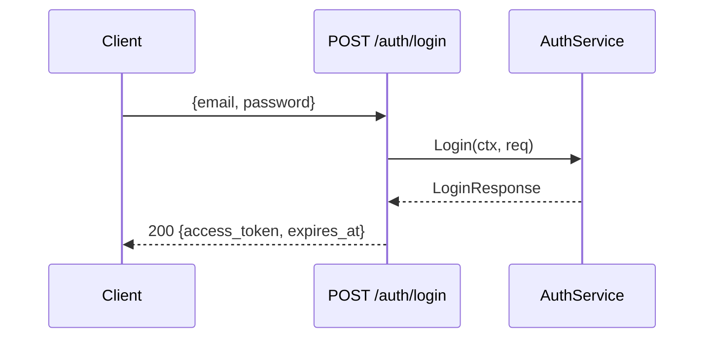

# PR Description Draft

Format for the pull request body drafted in `pragmatic-spec-build` Step 8. Every section is assembled from artifacts this plugin already produced — the spec, its `## Build Log`, and the `pragmatic-spec-check` report. Nothing is invented: a section whose source is empty is omitted, never filled with filler.

Write the draft in the spec's language. Keep prose brief; the reviewer can follow the links for depth.

## If the target repo has its own PR template

Check `.github/pull_request_template.md`, `.github/PULL_REQUEST_TEMPLATE.md`, `PULL_REQUEST_TEMPLATE.md`, and `docs/PULL_REQUEST_TEMPLATE.md`. If one exists, keep its headings and order, and fill each heading from the sources below. Leave a heading the sources can't answer with `[TODO: fill in]` rather than guessing.

## Sections and sources

| Section | Source | Rule |
|---|---|---|
| **Problem** | Spec section 2 | One or two sentences, from the user's perspective |
| **What changes** | Spec section 4, plus the section 6.3 diagram if one exists | The smallest view that makes the change clear — reuse the spec's Mermaid diagram as-is rather than drawing a new one |
| **Acceptance criteria** | Spec section 7 crossed with the `pragmatic-spec-check` report | One checkbox per AC with the test that covers it (`file:TestName`). State the spec-check result in the heading |
| **Evidence** | Build Log + spec-check report | The test command and its passing result; mention that each task's test was seen failing before its implementation (red → green) |
| **Decisions worth knowing** | Spec section 5 | Only rows a reviewer would question or could get wrong — always include the Test seam row |
| **Security** | Spec section 8 Security item | Non-`N/A` entries only, plus the security AC index. Omit the section if every entry is `N/A` |
| **Open items** | Build Log `### Parked Findings`, remaining `[TODO: ...]`, spec section 9 | One line each. Omit if empty |
| **Merge risk** | Spec section 8 (breaking changes, data model, dependencies) and section 6.2 | **Door:** `one-way` if the merge can't be undone by a revert alone (schema migration, published contract, data rewrite, breaking change for callers), otherwise `two-way`. **Blast radius:** one line naming what else is affected |
| **Links** | — | Spec path and its Build Log anchor |

## Example

Drawn from `pragmatic-spec-create/examples/example-auth-spec.md`:

````markdown
## Problem

The API has no authentication: every endpoint is publicly accessible as the product moves toward production.

## What changes

`POST /auth/login` issues a signed JWT (HS256, 24h); a middleware validates the
`Authorization: Bearer` header on every protected route.



## Acceptance criteria — spec-check: PASS

- [x] AC-1 valid credentials → 200 with signed JWT (`login_test.go:TestLogin_Valid`)
- [x] AC-2 wrong password → 401 `invalid_credentials` (`login_test.go:TestLogin_WrongPassword`)
- [x] AC-3 unknown email → 401, not 404 — no email enumeration (`login_test.go:TestLogin_UnknownEmail`)
- [x] AC-4 JWT signed HS256, expires in 24h (`login_test.go:TestLogin_TokenClaims`)
- [x] AC-5 protected route without `Authorization` → 401 (`middleware_test.go:TestProtected_NoHeader`)
- [x] AC-6 expired or badly signed token → 401 (`middleware_test.go:TestProtected_InvalidToken`)
- [x] AC-7 valid token → access with user context injected (`middleware_test.go:TestProtected_ValidToken`)
- [x] AC-8 `AUTH_JWT_SECRET` read from env, never hardcoded (`config_test.go:TestSecret_FromEnv`)

## Evidence

`go test ./internal/auth/...` — all passing. Each criterion's test was run failing before
its implementation existed (red → green, recorded per task in the Build Log).

## Decisions worth knowing

- Test seam: HTTP via `httptest` against a test PostgreSQL — no mocked repository.
- Symmetric signing (HMAC-SHA256): single-service deployment, no key distribution needed.

## Security

- No email enumeration: unknown email and wrong password return the same 401 (AC-3).
- Passwords compared with bcrypt (cost 12); JWT secret read from env only (AC-8); passwords, hashes and the secret are never logged.

## Open items

- Parked (Minor, task 4): middleware error message is hard-coded in English.

## Merge risk

**Door:** two-way — no migration; reverting removes the endpoint and the middleware.
**Blast radius:** routes the middleware is applied to start returning 401 to callers without a token.
`AUTH_JWT_SECRET` must be added to the ECS task definition secrets before deploy.

Spec: `docs/specs/auth.md` · Build Log: `docs/specs/auth.md#build-log`
````
